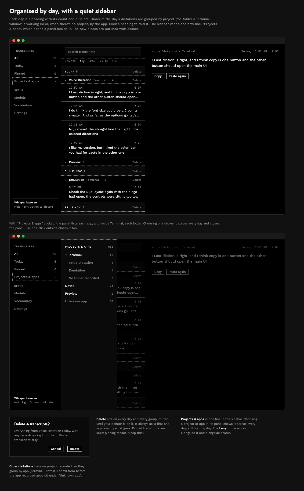
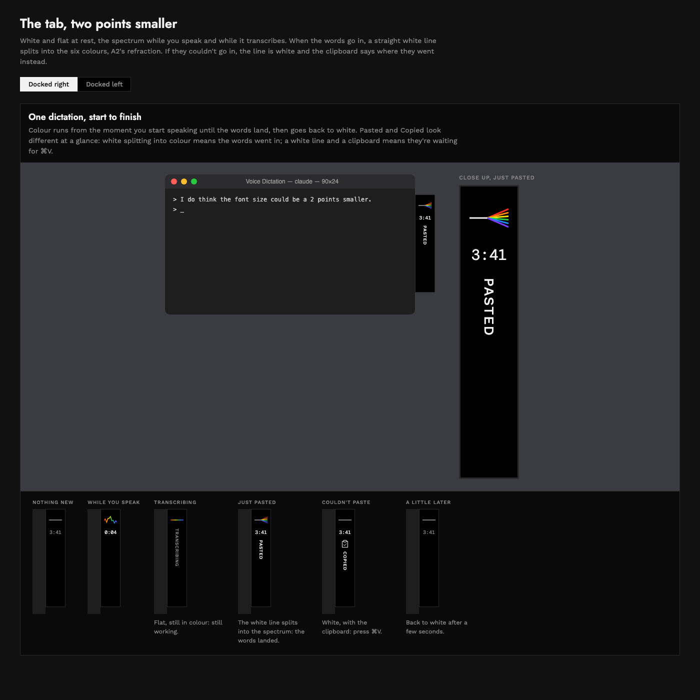

# Mini view, organising by day, and deleting: design

**Date:** 2026-11-21
**Status:** Design. Danny approved the mockups and the organisation in conversation, left the remaining tab choices to Claude, and asked for the plan to be written while he slept. Awaiting his read. Nothing here is built yet.
**Mockups:** `docs/superpowers/mockups/2026-11-21-mini-view-tab.png` (and `.html`), `docs/superpowers/mockups/2026-11-21-organise-by-day.png` (and `.html`). The HTML files load their fonts from the brainstorm server, so outside it they fall back to system fonts; the PNGs are the reference.

## Why

The app has two sizes today: the full window, or nothing but the menu bar icon and a pill at the bottom of the screen while you dictate. Danny wants something in between: a small view he can pull up whenever he likes, that sits on the edge of the window he is writing in and shows what the app is doing for that window right now.

The transcript list is one long column, newest first. After a week of dictating into Notes and several Claude Code sessions it is hard to find anything, and there is no quick way to clear out a batch. Danny wants it organised by day first, then by the project or app he was working in, with an easy way to delete.

He sees these together as worth "a larger version push" (1.1). Renaming the app comes after, separately.

## What Danny decided

These are his, and not for the builder to change.

**Mini view**
- Not a small copy of the app: a simple view of the current dictation and what is happening now. No live text.
- He can pull it up whenever he wants.
- It snaps to the window he is working in and stays with that window, docked on its right or left edge (his choice of edge; right and left first, he usually has room at the sides).
- It follows the window in front (option A). If the jumping bothers him, the fallback is option B: move only when a dictation starts in another window.
- The look: tab layout A, refined in the Prism style ("A2 refraction") with his change: a flat white line when nothing is new, the spectrum while he speaks.
- Pasted and Copied (couldn't paste) each have their own mark. Pasted is the straight white line splitting into the six colours (A2's refraction mark). Copied is a clipboard with a tick and the word.
- The tab's text two points smaller than the first mockup: the time 10 pt, the words 9 pt.
- Clicking the tab opens a panel with the last dictation, a Copy button, and a button that opens the main window.

**Organisation**
- By day first, then grouped by project, or by the app ("surface") when there is no project.
- Filters: one project or app across every day, and length.
- The left sidebar must not get busy: projects and apps open in a panel beside it rather than listing in it.

**Deleting**
- A clear, easy way to delete transcripts: Delete on each day and each group.

## Goals

- At a glance, from the edge of the window he is in, Danny can tell whether the app is listening, working, has just pasted into this window, or could only copy.
- One click on the tab gets the last dictation onto the clipboard, or opens the full window.
- A week of dictations reads as days, and inside each day as the projects and apps they went into.
- A day, or one project's dictations on a day, can be deleted in two clicks, with a clear confirmation.
- Nothing new leaves the Mac. The app reads only where a window is, its size and state, and the folder it is open on; never what is in it.

## Non-goals (not in this batch)

- Docking the tab on the top or bottom edge.
- A keyboard shortcut for the mini view (see Calls).
- Topics worked out by an AI model, or from Claude Code's session titles in the Terminal title bar (a good source for later: the titles read like "◐ CodingProjects folder sync").
- Grouping Notes dictations by note: Notes' window says only its folder and note count ("All iCloud – 464 notes").
- Undo for deletion. The confirmation is the safety.
- Renaming the app (logged in `docs/feature-requests.md`).
- A release. This batch ships as 1.1 only when Danny asks.

## Anti-goals (a failure even if it works)

- The tab taking focus from the app being dictated into, or its clicks activating VoiceDictation.
- The tab showing "Pasted" on a window the words did not go into.
- The sidebar growing a line per project.
- Deleting a pinned transcript in a bulk delete.
- Polling: the tab follows windows from macOS's notifications, never a timer.
- Colour anywhere but the tab's mark and the selected row's underline.

## Approaches

**Where "project" comes from.**
1. *The folder the window is open on, read through Accessibility (chosen).* Every Terminal window reports its working folder: Apple's shell setup (`/etc/zshrc_Apple_Terminal`, `update_terminal_cwd`) tells Terminal the folder at each prompt, and Accessibility exposes it as the window's document. Checked on the laptop on 2026-11-21: `AXDocument` gave `file:///Users/<name>/CodingProjects/Voice%20Dictation/` for a Claude Code window. Exact, instant, no AI.
2. Parsing window titles. Noisy: Terminal's title mixes the folder, Claude Code's session title, the process and the size.
3. Topics from the on-device model. Fuzzy, costs time on every dictation, can mislabel. Later, maybe.

**How the tab follows a window.**
1. *Accessibility observers on the front app's focused window (chosen).* macOS announces app switches, focus changes, moves, resizes, minimising and closing; the tab moves when told.
2. Polling `CGWindowListCopyWindowInfo`. Simple, but a timer that runs all day, lags behind drags, and needs Screen Recording for anything beyond bounds.
3. A tab fixed to the screen edge. Fails "snaps to the window I'm working on".

**How the list is grouped.**
1. *Group the listed rows in memory (chosen).* The store keeps fetching newest first; a pure function turns those rows into days and groups. Easy to test; 56 transcripts today, and thousands would still be instant.
2. Sectioned fetches. SwiftData has none; it would mean one fetch per day.

**Where projects and apps are chosen.**
1. *A panel that opens beside the sidebar (chosen; Danny's suggestion).* One line in the sidebar; the panel lists apps, with folders nested under their app.
2. Nesting them in the sidebar. Exactly what Danny asked to avoid.
3. A system popover or menu. Rounded corners and a shadow, both against Prism, and menus hide counts.

## Part 1: Where each dictation went

Each transcript gains a **project**: the name of the folder the window was open on when the text was pasted.

- `DictationOutcome.project: String?` and `Transcript.project: String?`. Optional, so no migration (the store's rule for new properties).
- The pipeline reads it at the same moment it reads the app's name, just before pasting, and for a failed or skipped dictation when it reports one. It comes from the paster, beside `frontmostAppName`: `Pasting.frontmostFolder: String?`.
- `PasteEngine` reads it: the frontmost app's focused window (`kAXFocusedWindowAttribute`), its `kAXDocumentAttribute`, as a URL. The project is the folder's last path component, percent-decoded, when the URL is a file URL to a directory. It is nil for a file (a document, not a folder), for the home folder (a Terminal at `~` is not a project), for `/`, when there is no window or no document, and when Accessibility is not granted.
- The folder is never logged, and nothing else about the window is read.
- Older transcripts have no project and group by app. Paste again does not change a transcript's project.

## Part 2: Organising the list



**Days.** The transcript list is a run of day headings, newest first. A heading reads "Today", "Yesterday", or the weekday and date in the Mac's locale ("Sun, Nov 15"; with the year when it is not this year). Days turn at midnight in the Mac's time zone, as the rows' times already do. Beside the title, the day's count (DM Mono, muted); at the right, Delete.

**Groups.** Under each day, its transcripts are grouped by **place**: the project when there is one, otherwise the app.
- A project group reads its folder name, then the app and count in mono: "Voice Dictation  Terminal · 4".
- An app group reads the app and count: "Notes  24".
- Transcripts with no app read "Unknown app", as the detail already says.
- Two apps open on the same folder are two groups (the place is app and folder together).
- Groups are ordered by their newest transcript, newest first; rows within a group newest first.

**Rows** stay as they are, except their muted line drops the app (the group says it): the time of day on the left ("12:52 AM", even on older days, since the heading gives the day) and the length on the right ("7s"). Rows sit indented under their group heading (34 pt from the left, as in the mockup).

**Folding.** Clicking a day or group heading folds it; clicking again opens it. All start open. Folds last while the app runs and are not saved. ↑ and ↓ move through visible rows only. Folding away the selected row moves the selection to the nearest visible row, as a deletion does.

**Where the grouping applies.** All, Today and Pinned are grouped the same way, and so are search results. Choosing a project or app (below) shows day headings only, since every row is from that one place.

**Projects & apps.** The sidebar's Transcripts group gains one line, "Projects & apps", with a "›". Clicking it opens a panel 240 pt wide, laid over the list beside the sidebar (`bg-elevated`, hairline edges). It lists every place that has transcripts:
- Apps by count, most first. An app with any project lists its folders nested under it, by count, plus "No folder recorded" for that app's transcripts without one. Each line has its count.
- "Unknown app" last.
- Choosing a line shows that place across every day, and closes the panel. Esc, clicking outside, or clicking the sidebar line again closes it too.
- While a place is showing, the sidebar line is in the text colour with the place's name under it in DM Mono 11, muted. Choosing All, Today or Pinned leaves it.

**Length.** A row under the search field: "LENGTH  Any  <10s  10s–1m  >1m", DM Mono 12, the chosen one in the text colour with a 1 pt underline. The boundaries are 10 s and 60 s (42 of Danny's 56 dictations are under 10 s). A transcript whose length is unknown (imported history) shows only under Any. Length, search, the section and a chosen place all apply together. The sidebar counts ignore length and search, as they ignore search today.

## Part 3: Deleting

- Every day heading and group heading has **Delete** at its right: Work Sans 12, muted, in the text colour under the pointer.
- It deletes exactly the unpinned transcripts listed under that heading, after the search and length filters, including any folded away under it. Pinned transcripts stay: pinning means "keep this".
- A heading with nothing it could delete (all pinned) shows no Delete.
- It always asks first, as the pinned-transcript deletion does today:
  - Title: "Delete 4 transcripts?" ("Delete 1 transcript?" for one).
  - Message for a group: "Everything from Voice Dictation today, with any recordings kept for them. Pinned transcripts stay." For a day: "Everything dictated today, …" (or "… on Sun, Nov 15, …"). With a search or length filter on: "The 4 shown under Voice Dictation today, …" or, for a day, "The 4 shown today, …".
  - Buttons: Delete (destructive) and Cancel.
- The store deletes them in one save, then removes their recordings. The edit being typed, playback and re-transcription messages for deleted transcripts end as they do for a single deletion. A selected transcript that goes hands the selection to the nearest remaining row.
- Deleting one transcript from the detail is unchanged.

## Part 4: The mini view



### The tab

A black strip 40 pt wide with a 1 pt hairline border, square corners, no shadow, standing just outside the window's right or left edge. From the top: 12 pt padding, the **mark** (26 × 18 pt), and under it, 8 pt apart, the time and a word. The time is DM Mono 10. The word is Work Sans 500 at 9 pt, upper case, tracking 0.8, turned to read top to bottom. Its height is that of its tallest state (measured, as the indicator measures its size) and it never changes between states.

| State | Mark | Time | Word |
|---|---|---|---|
| Nothing new, on the window the last dictation went into | flat white line | its time, muted | — |
| Nothing new, any other window | flat white line | — | — |
| While you speak | moving line in the spectrum | the recording's timer (`m:ss`), text colour | — |
| Transcribing or cleaning up | flat line in the spectrum | — | TRANSCRIBING (muted) |
| Just pasted, on that window | white line splitting into the six colours | time, text colour | PASTED |
| Couldn't paste (left on the clipboard) | flat white line | time, text colour | clipboard mark, COPIED |
| Failed | flat white line | time, text colour | FAILED (muted) |

- **The spectrum** runs left to right across the mark, red to violet, fixed in place while the line moves through it, as on the app icon.
- **The moving line** is the indicator's volume line at the tab's size: 26 pt wide and 18 pt tall, a vertex every 2.6 pt, 1.5 pt stroke. It hears the same levels the indicator does. With Reduce Motion on it holds flat, still in colour.
- **The split** (Pasted): a 1 pt white line from the left edge to the middle (x 0 to 12, y 9), then six 1 pt rays to the right edge at y 3, 5.4, 7.8, 10.2, 12.6 and 15, coloured `spectrum-1` to `spectrum-6` from top to bottom.
- **The clipboard** (Copied): 12 × 15 pt, a 1 pt white outline board with its clip and a tick (the mockup's paths).
- **Timing.** Pasted and Failed go back to "nothing new" after 4 seconds, Copied after 10, or sooner when the next dictation starts. "Nothing new" on the target window keeps showing the time until the next dictation.
- **Which window got it.** The window in front when the text pasted. The tab remembers it (in memory only) and shows Pasted, Copied, Failed and the time only while it sits on that window. On any other window the same moment shows just the line.

### Where it sits and how it follows

- It sits on the front window: the focused standard window (`AXStandardWindow`) of the frontmost app. When another window or app comes to the front, it moves there.
- Its top is 40 pt below the window's top edge, clear of the title bar. Its window side touches the window's edge, outside it.
- Right is the default. Dragging the tab across the window to the other side, and letting go nearer that side, docks it there; the side is saved and used for every window.
- If the chosen side would put the tab off the window's screen (the window is against that edge), it goes on the other side. If neither side has room (the window fills the screen's width), it sits just inside the window's edge on the chosen side.
- It hides while: no standard window is in front (the desktop, an app with no windows), the front window is full screen or minimised, or VoiceDictation itself is in front (the full window is open; you have the whole view).
- It moves with the window when macOS reports a move or resize, and goes when the window closes. While a window is being dragged, that is live if the app reports moves during the drag, and otherwise when the drag ends (Call 14).
- **The pill at the bottom of the screen** stays hidden while the tab is showing: the tab says the same thing. Whenever the tab is hidden (mini view off, full screen, no window), the pill works as today.

### The panel

Clicking the tab opens a panel beside it:

```
┌──────────────────────────────────────┐
│ Terminal · Voice Dictation  12:52 AM │   DM Mono 12, muted
│                                      │
│ I Last diction is right, and I think │   Work Sans 14, up to 8 lines
│ copy is one button and the other…    │
│                                      │
│ [ Copy ]  [ Open ]                   │   secondary buttons, compact
└──────────────────────────────────────┘
```

- 248 pt wide, `bg-elevated`, 1 pt hairline border, square, no shadow, no colour. Its top lines up with the tab's.
- It opens on the tab's far side from the window when there is room on the screen, otherwise over the window beside the tab.
- It shows the newest transcript that has text, wherever it went (so a dictation that landed in the wrong place can be copied from any window). The header names its app and project and its time as the rows say it.
- **Copy** puts the text on the clipboard and reads "Copied" with the clipboard mark for 2 seconds.
- **Open** brings VoiceDictation forward with the main window open (and so the tab hides).
- With nothing dictated yet: "Nothing dictated yet." and Open.
- It closes when the tab is clicked again, on a click anywhere else, when the front window changes, when a dictation starts, and after Open.
- Neither the tab nor the panel ever activates the app or takes the keyboard (except Open, on purpose).

### Turning it on

- A checkable "Mini View" item in the menu bar menu, under "Open VoiceDictation". Saved, so it is still on after a relaunch. Off by default.
- Without Accessibility the tab cannot find windows, so it stays hidden and the pill shows (dictation needs Accessibility anyway).

## Design system changes

`DESIGN.md` changes in the same change as the code:
- **Colour:** the spectrum may also appear in the mini view's mark, while a dictation is under way and just after it pastes. That is the mini view's only colour; the panel has none. The floating indicator still has none.
- **Typography:** two small sizes, for the mini view's tab only: `mono-small` (DM Mono 10) and `label-small` (Work Sans 500, 9, tracking 0.8, upper case).
- **Components:** the mini view tab, its three marks, and the panel; the day and group headings; the Projects & apps panel.

## What it touches

- `Sources/VoiceDictationLib/Pipeline/DictationState.swift`: `DictationOutcome.project`.
- `Sources/VoiceDictationLib/Store/Transcript.swift`: `Transcript.project`.
- `Sources/VoiceDictationLib/Pipeline/DictationPipeline.swift`: `Pasting.frontmostFolder`; read beside the app name.
- `Sources/VoiceDictationLib/PasteEngine.swift`: reads the folder.
- `Sources/VoiceDictationLib/Store/TranscriptStore.swift`: places and their counts, a filtered search, deleting several at once.
- `Sources/VoiceDictationUI/Window/LibraryModel.swift`: a place section, the length filter, grouping, folding, bulk deletion.
- `Sources/VoiceDictationUI/Window/TranscriptList.swift`, `Sidebar.swift`, `MainWindow.swift`: headings, the length row, the Projects & apps line and its panel.
- `Sources/VoiceDictationUI/Indicator/LevelLine.swift`: a size of its own for the tab.
- New, `Sources/VoiceDictationUI/MiniView/`: the window tracker, the tab's state, its placement, the panel windows and their views.
- `Sources/VoiceDictationUI/AppModel.swift`: owns the mini view; the pill's new rule.
- `Sources/VoiceDictationUI/MenuBar/MenuBarContent.swift`: the Mini View item.
- `Sources/VoiceDictationLib/PreferencesManager.swift`: whether the mini view is on, and its side.
- `DESIGN.md`, `CLAUDE.md` (architecture), `docs/feature-requests.md` (the rename).

## Testing

- Unit tests for every rule that is logic: the folder rule; outcomes and transcripts carrying the project; grouping (days across midnight and time zones, group order, unknown apps, a folder in two apps); places and counts; the filtered search; bulk deletion (pinned kept, recordings removed, selection moved); folding and the keyboard; the tab's state over time (with a test clock); where the tab and panel go (both sides, no room, inside, two screens, Accessibility's flipped coordinates); the pill's rule; the menu item and saved preferences.
- The window tracker talks to macOS and is checked by hand: a stand-in replaces it in tests.
- Danny's hands-on checks, after the build: the tab follows Terminal, Notes and a browser; dragging it to the left; full screen; the panel's Copy and Open; a new Claude Code dictation grouped under its folder; deleting a day.

## Calls made on Danny's behalf (check these while reading)

1. Transcribing is a flat line in the spectrum (not the last shape held).
2. Pasted goes back to rest after 4 seconds, Copied after 10, Failed after 4.
3. After a paste the app keeps putting back what was on the clipboard before (unchanged). Copied shows only when a paste failed, or you pressed Copy.
4. The tab shows the time and Pasted only on the window the words went into; elsewhere just the line.
5. The tab hides in full screen, with no window in front, and while VoiceDictation is in front; the bottom pill takes over whenever it is hidden.
6. The panel opens on a click, not on hover, and shows the newest dictation wherever it went.
7. No keyboard shortcut in this batch: the menu item turns it on and off. A global shortcut means another key in the hotkey's event tap, the most delicate part of the app; it is easy to add later.
8. "Project" is a window's folder, so today it comes from Terminal (and any app whose window is open on a folder); a Terminal at the home folder counts as none.
9. Notes dictations group as "Notes" (Notes does not say which note).
10. Deleting from a heading deletes exactly what is listed under it, after filters, and never pinned transcripts.
11. Folds are not saved; everything opens unfolded.
12. Length boundaries at 10 s and 60 s.
13. The tab's height is fixed at its tallest state; its top 40 pt below the window's top.
14. While a window is dragged, the tab catches up when macOS reports the move: during the drag if the app reports it then, otherwise at the end. Hiding the tab during a drag, or following the mouse, would each need a global mouse monitor; they wait until Danny has seen the simple version.
15. A heading's Delete includes rows folded away under it.
16. The tab's time is the hour and minute without AM or PM ("12:52"), to fit 40 pt; only for a dictation made today.

## Open question for Danny (built with the default unless he says otherwise)

**When should the tab say Copied?** As designed it says Copied only when the app could not send ⌘V. That happens when Accessibility is missing, and then the tab is hidden anyway. So in practice it shows only after the panel's Copy. The app cannot tell whether a paste landed in a text field: pasting into Finder, or a window with nothing focused, counts as Pasted. Making Copied cover those cases would mean reading what has focus in the front window, and skipping ⌘V when it is not text. That changes the paste path, one of the most delicate parts of the app, and breaks this design's rule of reading nothing but the window's place and folder. **Default: as designed.** Worth revisiting if a paste into the void turns out to bite.

## Left to the builder

- How the tracker manages its `AXObserver`s as apps come and go, and how often it re-reads a frame during a drag (on each notification is enough).
- The panel window's level, so it sits above the front window and below menus and alerts.
- How the vertical word is drawn and measured.
- Empty-state wording for a length or place with no matches, in the style of the existing messages.

## Things to verify early

- Terminal sends move and resize notifications through Accessibility (the attributes were read on 2026-11-21; the notifications were not tried), and whether moves arrive during a drag or only at its end (Call 14).
- A non-activating panel can take clicks without activating the app, and stays beside the front window across Spaces.
- A global mouse-down monitor (to close the panel) works with the permissions the app already has.
